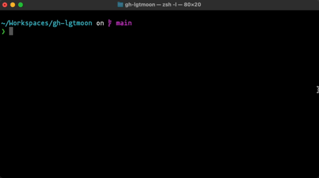

# gh lgtmoon

GitHub CLI extension to retrieve LGTM images.

## Installation:

```sh
gh extension install yug1224/gh-lgtmoon
```

The extension depends on bash and curl (available on macOS, Linux, and Windows Git Bash). It prefers `/usr/bin/curl` when that binary runs, so a broken Homebrew `curl` on `PATH` is not used.

## Usage:

```sh
gh lgtmoon
```

On success, the command prints Markdown to stdout (one trailing newline):

```text

```

Stdout contains Markdown only. The same string is copied to the clipboard on a best-effort basis using whichever tool is available:

- `pbcopy` (macOS)
- `clip.exe` (Git Bash / WSL)
- `wl-copy` (Wayland, when `WAYLAND_DISPLAY` is set)
- `xclip` or `xsel` (X11, when `DISPLAY` is set)

If no clipboard tool is available or copying fails, the command still succeeds (exit 0) and prints `gh-lgtmoon: clipboard copy skipped` to stderr.

Previously, the extension copied to the clipboard via macOS-only `pbcopy` ([Issue #2](https://github.com/YuG1224/gh-lgtmoon/issues/2)); that behavior was removed in 2022 and is now restored with cross-platform clipboard support.

### Failures

- If `curl` cannot be found or cannot run, the command prints `gh-lgtmoon: curl not found` to stderr and exits with a non-zero status.
- If `curl` cannot reach the API, the command exits with a non-zero status and prints the curl error to stderr.
- If the response does not contain a usable image URL, the command prints `gh-lgtmoon: failed to extract image URL` or `gh-lgtmoon: invalid image URL` to stderr and exits with a non-zero status.



## License

MIT

## Author

Yuji Yamaguchi (a.k.a. yug1224)
